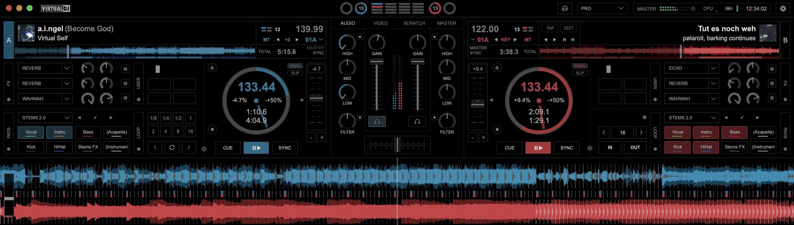
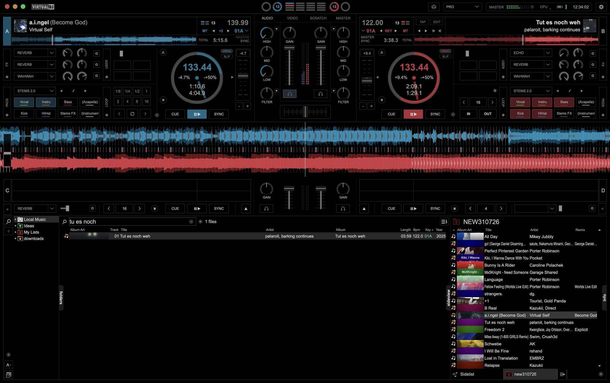

# Pro OLED for VirtualDJ

A pure-black version of VirtualDJ’s **Pro** layout, made to blend into a black desktop.

## Changes

| Element | Change | Type |
| --- | --- | --- |
| Decks, mixer, waveforms and browser | Pure-black backgrounds (`#000000`). | Modified |
| Phrase-sync indicators and beat counters | Inactive phrase-sync markers `#303030`; inactive beat markers and rings `#484848`; counter text `#B8B8B8`. | Modified |
| Top phrase counters | Circles only in macOS fullscreen: A/C left of the notch, B/D right. | Modified |
| Top beat bars | Hidden in macOS fullscreen on notched displays. | Removed |
| Jog wheels | Rings and borders `#484848`; position markers `#A6A6A6`; labels and time text `#B0B0B0`. | Modified |
| Sandbox, Shoutout, Event Scheduler and account box | Hidden from the toolbar. | Removed |
| Layout, status and Settings | Grouped on the right on macOS. | Modified |
| Tap, Edit and beat-grid controls | Always visible; clicking BPM no longer toggles them. | Modified |
| VirtualDJ logo | Reduced to 72 × 17 beside the window controls. | Modified |
| Deck colours and remaining controls | Original colours and behaviour. | Unchanged |

## Install

1. Download **[Pro-OLED.zip](https://github.com/elxrrr/virtualdj-pro-oled/releases/latest/download/Pro-OLED.zip)** from the latest release.
2. Copy `Pro-OLED.zip` into your VirtualDJ `Skins` folder without extracting it.
3. Select **Pro OLED** in **Settings → Interface**. Select **OLED Black** in the layout menu’s colour scheme options if needed.

## Full interface

