# Pro Pure Black for VirtualDJ

A pure-black version of VirtualDJ’s **Pro** layout, made to blend into a black desktop.

**[Generate your skin →](https://elxrrr.github.io/pro-pure-black/)** Choose your toolbar, logo and palettes in one live preview. Select whole Pastel, Bold or Aesthetic groups, mix individual palettes, or create your own. Only Default is selected initially; its Atomix colours are always retained.

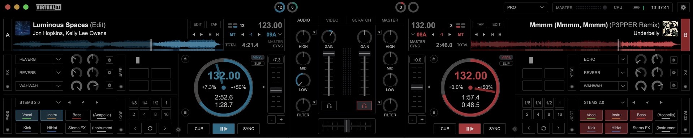

## Changes

| Element | Change |
| --- | --- |
| Decks, mixer, waveforms and browser | Pure-black backgrounds (`#000000`). |
| Browser and sidelist scroll indicators | Visible grey (`#606060`) across all palettes. |
| Phrase-sync indicators and beat counters | Inactive phrase-sync markers `#303030`; inactive beat markers and rings `#484848`; counter text `#B8B8B8`. |
| Top phrase counters | When VirtualDJ reports a notch: A/C circles left of it, B/D right. |
| Top beat bars | Hidden only while VirtualDJ’s notch layout is active; the normal bars/circles setting is retained otherwise. |
| Waveform zoom slider | Hidden; scrollwheel zoom retained. |
| Shape waveforms | Vocal, instrumental and beat layers follow the selected deck colour using darker and lighter shades. Default retains the original waveform colours. |
| Mixer level meters | Follow each deck’s theme colour, retaining segmented bars and `#BEBEBE` peak segments. Default retains the original meters. |
| Jog wheels | Rings and borders `#484848`; position markers `#A6A6A6`; labels and time text `#B0B0B0`. |
| Sandbox, Shoutout, Event Scheduler and account box | Hidden by default; individually configurable in the skin builder. |
| Builder toolbar | Master, CPU, battery and clock individually configurable beside the logo on the left; CPU and battery off by default. Buttons grouped on the right in your chosen order. In narrow Mac windows, Account moves before Master; when the notch layout is active and all controls are included, Account hides to make room. |
| Custom logo | Optional transparent PNG after the master/status block. Logo tint uses Deck A for each palette and soft grey `#959595` for Default; switch it off to keep the PNG’s original colours. |
| Tap, Edit and beat-grid controls | Always visible; clicking BPM no longer toggles them. |
| VirtualDJ logo | Reduced to 72 × 17 beside the window controls. |
| Deck colours | Default retains the original colours. A standalone Grayscale palette, Pastel/Bold groups covering Red, Orange, Yellow, Green, Blue, Purple and Pink, plus seven mixed-colour Aesthetic palettes. |
| Remaining controls | Original behaviour. |

## Deck colours

All themes keep `#000000` backgrounds. Rendered previews show decks **A, B, C, D**, with contrasting colours within the A/B and C/D pairs. Default retains Atomix’s original order.

| Default | Grayscale |
| --- | --- |
| <a href="screenshots/themes/default.png">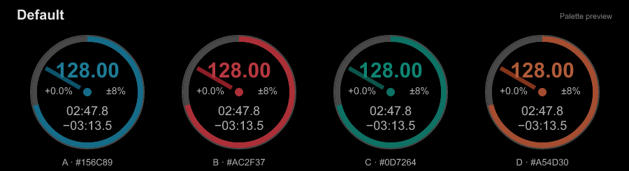</a> | <a href="screenshots/themes/grayscale.png">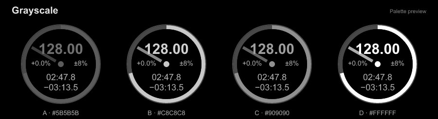</a> |

| Pastel | Bold |
| --- | --- |
| <a href="screenshots/themes/pastel-red.png">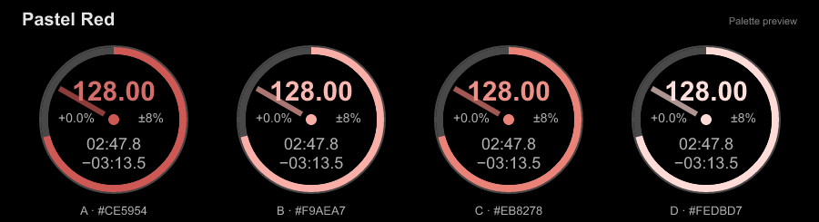</a> | <a href="screenshots/themes/bold-red.png">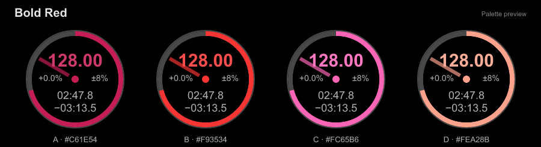</a> |
| <a href="screenshots/themes/pastel-orange.png">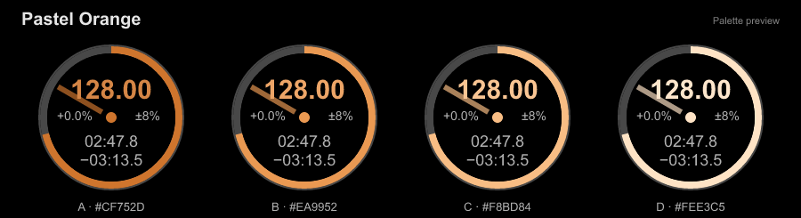</a> | <a href="screenshots/themes/bold-orange.png">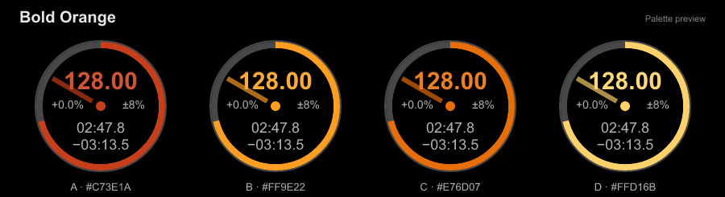</a> |
| <a href="screenshots/themes/pastel-yellow.png">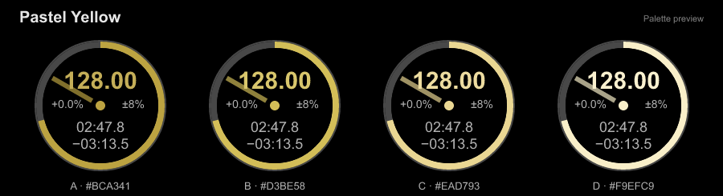</a> | <a href="screenshots/themes/bold-yellow.png">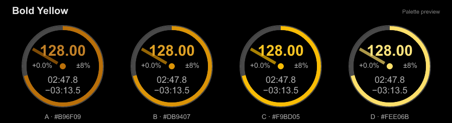</a> |
| <a href="screenshots/themes/pastel-green.png">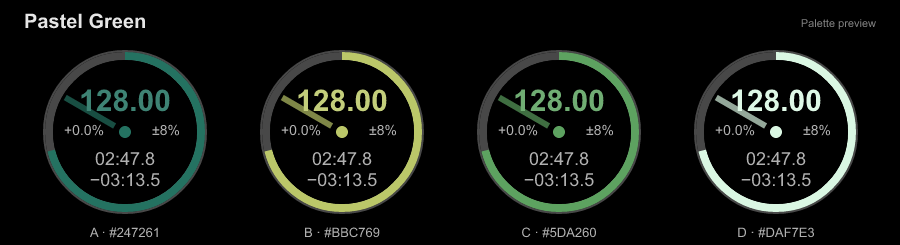</a> | <a href="screenshots/themes/bold-green.png">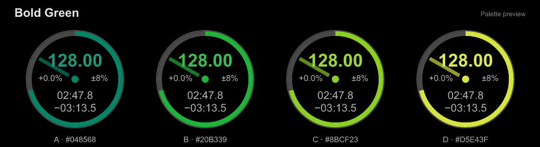</a> |
| <a href="screenshots/themes/pastel-blue.png">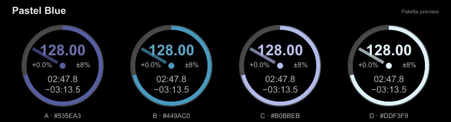</a> | <a href="screenshots/themes/bold-blue.png">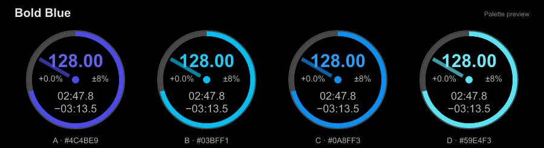</a> |
| <a href="screenshots/themes/pastel-purple.png">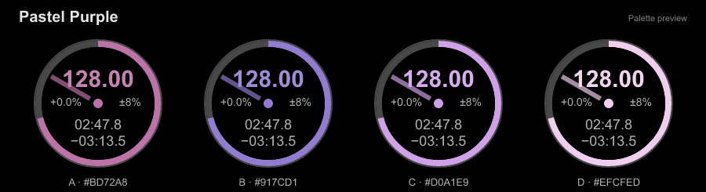</a> | <a href="screenshots/themes/bold-purple.png">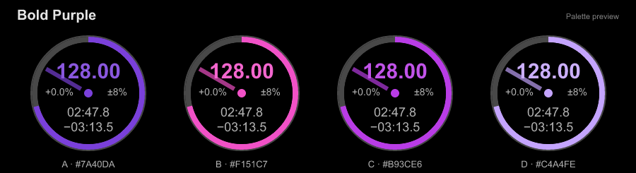</a> |
| <a href="screenshots/themes/pastel-pink.png">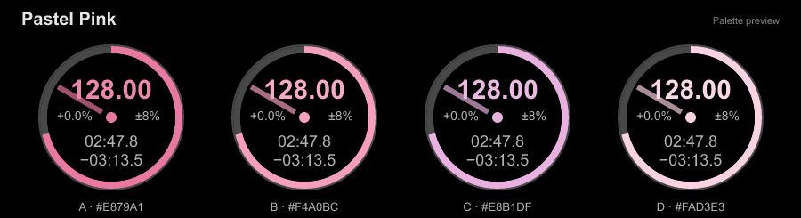</a> | <a href="screenshots/themes/bold-pink.png">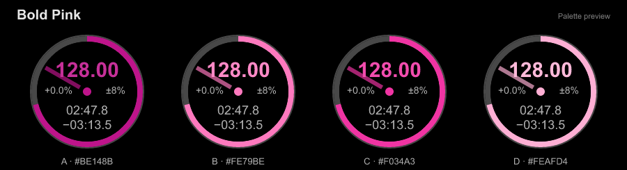</a> |

| Aesthetic palettes | |
| --- | --- |
| <a href="screenshots/themes/aesthetic-daydream.png">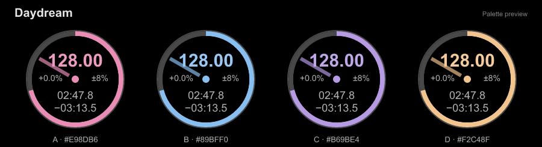</a> | <a href="screenshots/themes/aesthetic-ghost-in-the-shell.png">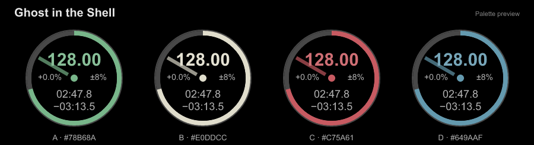</a> |
| <a href="screenshots/themes/aesthetic-outrun.png">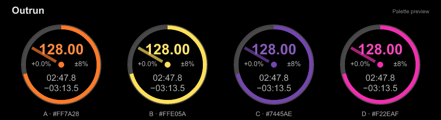</a> | <a href="screenshots/themes/aesthetic-cozycore.png">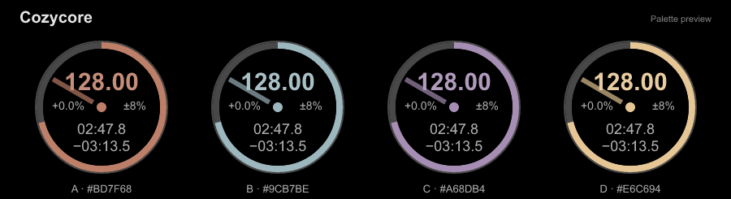</a> |
| <a href="screenshots/themes/aesthetic-cottagecore.png">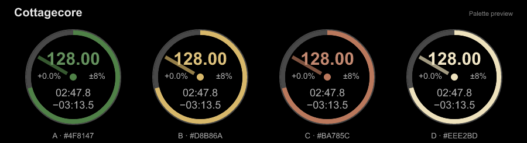</a> | <a href="screenshots/themes/aesthetic-afterglow.png">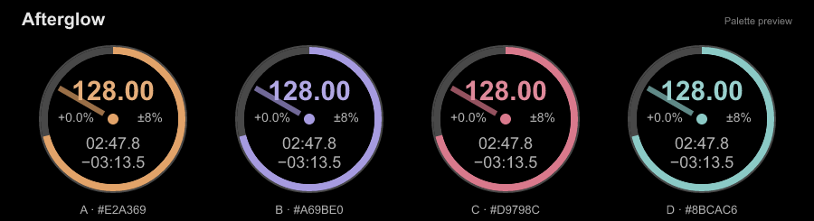</a> |
| <a href="screenshots/themes/aesthetic-moon-garden.png">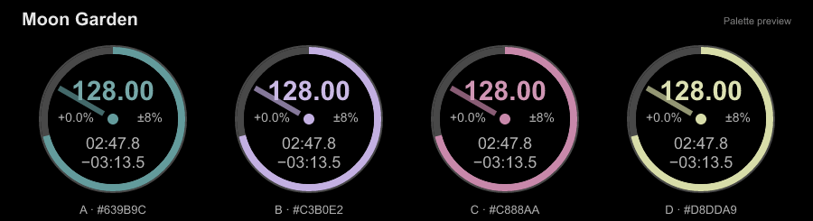</a> |  |
