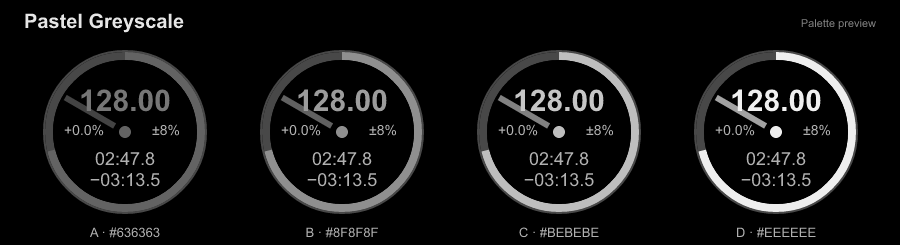
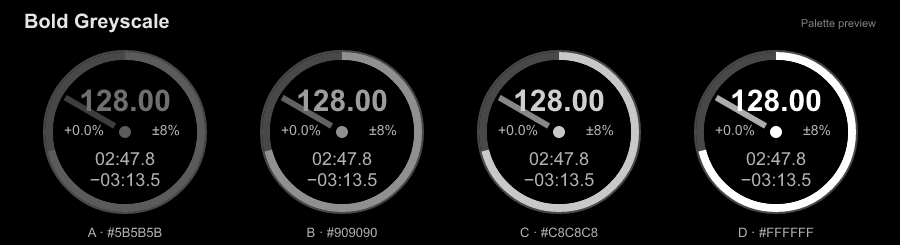

# Pro Pure Black for VirtualDJ

A pure-black version of VirtualDJ’s **Pro** layout, made to blend into a black desktop.

**[Build your own skin →](https://elxrrr.github.io/pro-pure-black/)** Choose and reorder toolbar buttons, preview the notch layout, add a transparent PNG logo and create your own four-deck palettes with animated previews. Select whole Pastel or Bold groups, or mix individual palettes. Download your ZIP. Default is always included with Atomix’s original colours.

## Changes

| Element | Change |
| --- | --- |
| Decks, mixer, waveforms and browser | Pure-black backgrounds (`#000000`). |
| Browser and sidelist scroll indicators | Visible grey (`#606060`) across all palettes. |
| Phrase-sync indicators and beat counters | Inactive phrase-sync markers `#303030`; inactive beat markers and rings `#484848`; counter text `#B8B8B8`. |
| Top phrase counters | Circles only in macOS fullscreen: A/C left of the notch, B/D right. |
| Top beat bars | Hidden in macOS fullscreen on notched displays; retained in windowed view. |
| Waveform zoom slider | Hidden; scrollwheel zoom retained. |
| Shape waveforms | Vocal, instrumental and beat layers follow the selected deck colour using darker and lighter shades. Default retains the original waveform colours. |
| Mixer level meters | Follow each deck’s theme colour, retaining segmented bars and `#BEBEBE` peak segments. Default retains the original meters. |
| Jog wheels | Rings and borders `#484848`; position markers `#A6A6A6`; labels and time text `#B0B0B0`. |
| Sandbox, Shoutout, Event Scheduler and account box | Hidden by default; individually configurable in the skin builder. |
| Builder toolbar | Master, CPU, battery and clock beside the logo on the left; buttons grouped on the right in your chosen order. The 13″ Air profile automatically hides Account when all other controls are enabled. |
| Tap, Edit and beat-grid controls | Always visible; clicking BPM no longer toggles them. |
| VirtualDJ logo | Reduced to 72 × 17 beside the window controls. |
| Deck colours | Default retains the original colours. Pastel and Bold groups each include Red, Orange, Yellow, Green, Blue, Purple and Greyscale. |
| Remaining controls | Original behaviour. |

## Install

1. Download **[pro-pure-black.zip](https://github.com/elxrrr/pro-pure-black/releases/latest/download/pro-pure-black.zip)** from the latest release.
2. Copy `pro-pure-black.zip` into your VirtualDJ `Skins` folder without extracting it.
3. Select **Pro Pure Black** in **Settings → Interface**. Choose a palette under **Layout → Deck Colours**.

## Deck colours

All themes keep `#000000` backgrounds. Rendered previews show decks **A, B, C, D**, using the skin’s palette values.

### Pastel

### Bold

